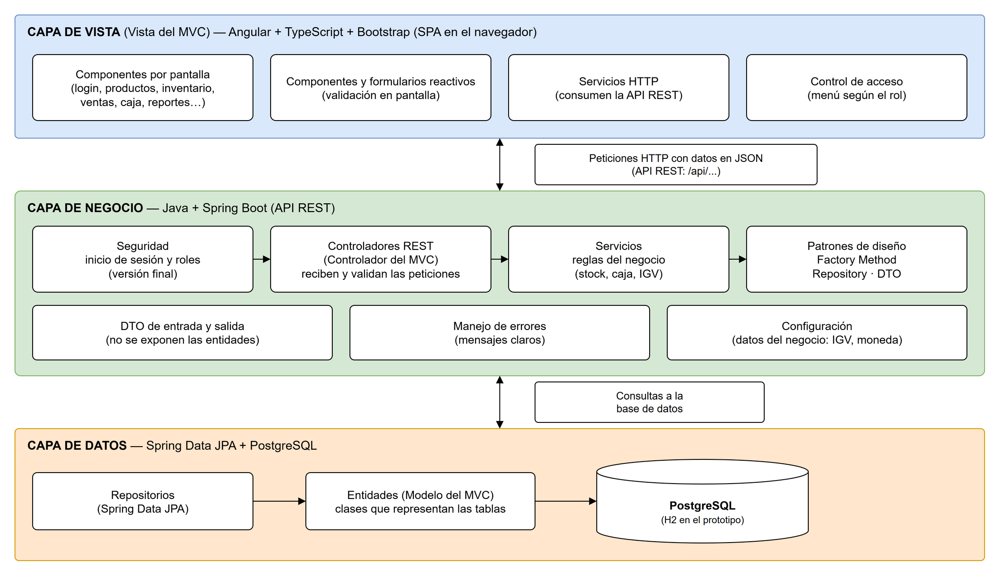

# Sistema web de ventas en mostrador e inventario para una ferretería

Sistema para una ferretería: el vendedor registra las ventas en el mostrador con boleta o factura y
maneja su turno de caja; el administrador controla los productos, el stock, el kardex, los reportes
y los usuarios. Los clientes de la ferretería consultan un catálogo público de productos, precios y
disponibilidad. Proyecto académico del curso *Proyecto Integración de los Componentes de las Capas
de Datos, Negocio y Vista* (IDAT).

Arquitectura en tres capas que aplica el patrón MVC:

```
Vista (Angular + Bootstrap)  ──HTTP/JSON + JWT──▶  Negocio (Spring Boot, API REST)  ──JPA──▶  Datos (PostgreSQL)
   frontend/  puerto 4200                              backend/  puerto 8081
```



## Tecnologías

- **Vista:** Angular, TypeScript y Bootstrap.
- **Negocio:** Java 21 y Spring Boot (Web, Data JPA, Validation y Security con JWT).
- **Datos:** PostgreSQL 16 (H2 opcional para probar sin instalar nada).
- **Pruebas:** JUnit, Mockito y Spring Boot Test.
- **Documentación de la API:** Swagger UI en http://localhost:8081/swagger-ui/index.html

## Pantallas

| Pantalla | Quién la usa | Qué hace |
|---|---|---|
| Catálogo | Público, sin iniciar sesión | Busca productos por nombre o categoría; muestra precio y si hay stock |
| Inicio de sesión | Todos | Usuario y contraseña validados en el backend; entrega un token JWT |
| Panel principal | Ambos roles | Ventas del día, estado de la caja, indicadores y alertas de stock |
| Ventas | Ambos roles | Carrito, IGV, boleta o factura (con DNI o RUC), registro y comprobante para imprimir |
| Clientes | Ambos roles | Registrar, buscar y editar clientes con DNI o RUC |
| Caja | Ambos roles | Abrir el turno y cerrarlo con el efectivo contado (sobrante o faltante) |
| Productos | Administrador | Listar, buscar, crear, editar, activar y desactivar |
| Inventario y kardex | Administrador | Entradas con el documento del proveedor, salidas, ajustes y kardex |
| Reportes | Administrador | Ventas, utilidad y rotación por periodo; lista de comprobantes y anulación |
| Usuarios | Administrador | Crear usuarios y activarlos o desactivarlos |

Usuarios de prueba: `admin / admin123` (administrador) y `vendedor / vendedor123` (vendedor).

El envío del comprobante a SUNAT mediante un Proveedor de Servicios Electrónicos (PSE) no está
implementado: cada venta queda con el envío en estado *pendiente*.

## Cómo correrlo

Requisitos: JDK 21, Node.js 20 o superior y PostgreSQL 16 (o Docker).

1. **Base de datos.** Con Docker, desde la carpeta `backend`:

   ```
   docker compose up -d
   ```

   Sin Docker, crear en PostgreSQL la base `ferreteria` con el usuario `ferreteria` y la contraseña
   `ferreteria`, o indicar otros datos con las variables `DB_URL`, `DB_USUARIO` y `DB_CLAVE`.

2. **Backend** (abrir la carpeta `backend` en IntelliJ y ejecutar `FerreteriaApiApplication`, o por terminal):

   ```
   cd backend
   mvnw spring-boot:run
   ```

   Las tablas se crean solas. La primera vez carga los dos usuarios de prueba y un catálogo de
   ejemplo (11 productos en 5 categorías).

   Para probar sin PostgreSQL: `mvnw spring-boot:run -Dspring-boot.run.profiles=h2`
   (la base queda en `backend/data/`).

3. **Frontend**:

   ```
   cd frontend
   npm install
   npm start
   ```

   Abrir http://localhost:4200 (el catálogo público está en http://localhost:4200/catalogo).

## Capas del backend

| Paquete | Capa | Qué contiene |
|---|---|---|
| `controller` | Presentación de la API | Recibe las peticiones HTTP y devuelve JSON |
| `service` | Negocio | Reglas: stock nunca negativo, numeración de comprobantes, IGV, reglas de boleta y factura, cierre de caja |
| `repository` | Datos | Interfaces de Spring Data JPA |
| `model` | Datos | Entidades: `Categoria`, `Producto`, `MovimientoKardex`, `Cliente`, `Venta`, `DetalleVenta`, `TurnoCaja`, `Usuario` |
| `security` | Seguridad | Reglas de acceso por rol, generación y validación del token JWT |
| `dto` | — | Objetos de entrada y salida de la API, con validaciones |
| `exception` | — | Convierte los errores en respuestas claras (400, 401, 403, 404, 409) |

## Seguridad

- Las contraseñas se guardan con **BCrypt**; la API nunca devuelve la contraseña ni su hash.
- Al iniciar sesión, la API entrega un **token JWT** firmado (HS256) que vence en 8 horas y lleva el rol.
  Sin token la API responde 401; con un rol sin permiso, 403.
- El vendedor no puede crear productos, mover inventario, ver reportes, anular ventas ni manejar usuarios.
- Contraseñas nuevas: al menos 8 caracteres, con letras y números.
- El catálogo público no muestra el precio de compra ni el stock exacto.
- La clave de firma se define con la variable de entorno `JWT_SECRETO` en un servidor real.

## Patrón creacional: Factory Method

Cada cambio de stock crea un movimiento del kardex, y cada tipo se crea distinto:

- **Entrada**: suma la cantidad (exige el documento del proveedor).
- **Salida**: resta la cantidad; las ventas usan este tipo.
- **Ajuste**: la cantidad es lo contado en el inventario físico; el movimiento guarda la diferencia.
- **Devolución**: devuelve al stock lo de una venta anulada.

`CreadorMovimiento` (clase abstracta) tiene el método fábrica `crearMovimiento(...)` y los pasos
comunes (validar que el stock no quede negativo y actualizar el producto). Cada subclase decide cómo
se crea su movimiento. La devolución se agregó como una subclase nueva, sin modificar las demás.

Código: `backend/src/main/java/pe/idat/ferreteria/service/kardex/`

## Endpoints

| Método | Ruta | Acceso | Descripción |
|---|---|---|---|
| POST | `/api/auth/login` | Público | Inicia sesión y devuelve el token |
| GET | `/api/catalogo?buscar=&categoriaId=` | Público | Catálogo para clientes |
| GET | `/api/catalogo/categorias` | Público | Categorías del catálogo |
| GET | `/api/panel/resumen` | Ambos roles | Indicadores del panel y ventas del día |
| GET | `/api/productos?buscar=&soloActivos=` | Ambos roles | Buscar por código o descripción |
| GET | `/api/productos/alertas` | Ambos roles | Productos con stock bajo el mínimo |
| POST · PUT · PATCH | `/api/productos/...` | Administrador | Crear, editar, activar y desactivar |
| GET · POST | `/api/categorias` | Ver: ambos · Crear: administrador | Categorías |
| GET · POST | `/api/movimientos` | Administrador | Kardex y registro de entradas, salidas y ajustes |
| POST | `/api/ventas` | Ambos roles | Registrar una venta con boleta o factura |
| GET | `/api/ventas?desde=&hasta=` | Ambos roles | Ventas del periodo (por defecto, hoy) |
| PATCH | `/api/ventas/{id}/anular` | Administrador | Anular una venta y devolver su stock |
| GET · POST · PUT | `/api/clientes` | Ambos roles | Buscar, registrar y editar clientes |
| GET | `/api/caja/actual` | Ambos roles | Turno abierto del usuario (204 si no tiene) |
| POST | `/api/caja/abrir` · `/api/caja/cerrar` | Ambos roles | Abrir y cerrar el turno de caja |
| GET | `/api/reportes/ventas?desde=&hasta=` | Administrador | Ventas, utilidad y rotación |
| GET · POST · PATCH | `/api/usuarios` | Administrador | Listar, crear, activar y desactivar usuarios |

## Pruebas

```
cd backend
mvnw test
```

53 pruebas, con una base H2 en memoria:

- **Unitarias** (sin Spring ni base de datos):
  - `CreadorMovimientoTest`: 8 pruebas del Factory Method.
  - `VentaServiceTest`: 11 pruebas de la lógica de ventas con Mockito (IGV, numeración, reglas de
    boleta y factura, producto desactivado, anulación).
  - `UsuarioServiceTest`: 6 pruebas de inicio de sesión y registro de usuarios (BCrypt).
- **Integración** (controlador, servicio y repositorio juntos):
  - `ApiIntegracionTest`: 12 pruebas de productos, categorías, kardex y panel.
  - `VentaIntegracionTest`: 7 pruebas que cruzan ventas, kardex, clientes, reportes y caja; por
    ejemplo, que una venta anulada devuelve el stock y deja de sumar en el reporte y en la caja, y que
    una venta rechazada no deja stock descontado.
  - `SeguridadIntegracionTest`: 9 pruebas con tokens reales (sin token, token alterado, permisos por
    rol, contraseña débil, catálogo público).

## Licencia

MIT. Ver [LICENSE](LICENSE).
