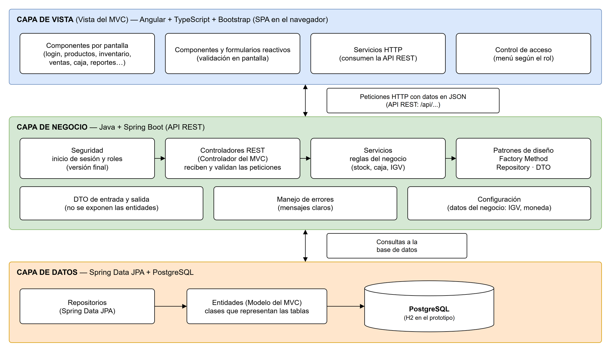

# Sistema web de ventas en mostrador e inventario para una ferretería

Prototipo de un sistema de uso interno para una ferretería: el vendedor registra las ventas en el
mostrador con boleta o factura, y el administrador controla los productos, el stock y el kardex.
El cliente de la ferretería no usa el sistema. Proyecto académico del curso *Proyecto Integración de
los Componentes de las Capas de Datos, Negocio y Vista* (IDAT).

Arquitectura en tres capas que aplica el patrón MVC:

```
Vista (Angular + Bootstrap)  ──HTTP/JSON──▶  Negocio (Spring Boot, API REST)  ──JPA──▶  Datos (H2 / PostgreSQL)
   frontend/  puerto 4200                        backend/  puerto 8081
```



## Tecnologías

- **Vista:** Angular, TypeScript y Bootstrap.
- **Negocio:** Java 21 y Spring Boot (Web, Data JPA y Validation).
- **Datos:** H2 en el prototipo; PostgreSQL en el sistema final.
- **Pruebas:** JUnit con Spring Boot Test.

## Qué funciona y qué es de ejemplo

| Pantalla | Estado |
|---|---|
| Inicio de sesión | Funciona con dos usuarios de demostración (sin backend todavía) |
| Panel principal | Indicadores y alertas de stock **reales** desde la API |
| Productos y categorías | **Funcional**: listar, buscar, crear, editar, activar/desactivar |
| Inventario y kardex | **Funcional**: entradas con la guía o comprobante del proveedor, salidas y ajustes; kardex con búsqueda por documento y alertas de stock mínimo |
| Ventas | Búsqueda de productos **real**; carrito, IGV y elección de boleta o factura (con validación de DNI o RUC) en la vista; la venta y el comprobante aún no se guardan |
| Clientes, Caja, Reportes, Usuarios | Pantallas con datos de ejemplo |

Usuarios de demostración: `admin / admin123` (administrador) y `vendedor / vendedor123` (vendedor).
El vendedor solo ve Panel, Ventas, Clientes y Caja.

## Cómo correrlo

Requisitos: JDK 21 y Node.js 20 o superior.

1. **Backend** (abrir la carpeta `backend` en IntelliJ y ejecutar `FerreteriaApiApplication`, o por terminal):

   ```
   cd backend
   mvnw spring-boot:run
   ```

   La primera vez carga un catálogo de ejemplo (11 productos en 5 categorías).
   La base de datos queda en `backend/data/`; para empezar de cero, se borra esa carpeta.

2. **Frontend**:

   ```
   cd frontend
   npm install
   npm start
   ```

   Abrir http://localhost:4200

## Capas del backend

| Paquete | Capa | Qué contiene |
|---|---|---|
| `controller` | Presentación de la API | Recibe las peticiones HTTP y devuelve JSON |
| `service` | Negocio | Reglas: código único, precio de venta ≥ precio de compra, stock nunca negativo |
| `repository` | Datos | Interfaces de Spring Data JPA |
| `model` | Datos | Entidades: `Categoria`, `Producto`, `MovimientoKardex` |
| `dto` | — | Objetos de entrada y salida de la API, con validaciones |
| `exception` | — | Convierte los errores en respuestas claras (400, 404, 409) |

## Patrón creacional: Factory Method

Cada cambio de stock crea un movimiento del kardex, y cada tipo se crea distinto:

- **Entrada**: suma la cantidad.
- **Salida**: resta la cantidad.
- **Ajuste**: la cantidad es lo contado en el inventario físico; el movimiento guarda la diferencia.

`CreadorMovimiento` (clase abstracta) tiene el método fábrica `crearMovimiento(...)` y los pasos
comunes (validar que el stock no quede negativo y actualizar el producto). Las subclases
`CreadorEntrada`, `CreadorSalida` y `CreadorAjuste` deciden cómo se crea su movimiento.
`KardexService` elige el creador según el tipo pedido. Para agregar un tipo nuevo (por ejemplo,
devolución) se crea otra subclase sin modificar las existentes.

Código: `backend/src/main/java/pe/idat/ferreteria/service/kardex/`

## Endpoints

| Método | Ruta | Descripción |
|---|---|---|
| GET | `/api/panel/resumen` | Indicadores del panel |
| GET | `/api/categorias` | Lista de categorías |
| POST | `/api/categorias` | Crear categoría |
| GET | `/api/productos?buscar=&soloActivos=` | Buscar por código o descripción |
| GET | `/api/productos/alertas` | Productos con stock bajo el mínimo |
| GET | `/api/productos/{id}` | Ver un producto |
| POST | `/api/productos` | Crear producto |
| PUT | `/api/productos/{id}` | Editar producto (el stock no se edita aquí) |
| PATCH | `/api/productos/{id}/activar` · `/desactivar` | Cambiar estado |
| GET | `/api/movimientos?productoId=&documento=` | Kardex; con `documento`, lo que ingresó con esa guía o comprobante |
| POST | `/api/movimientos` | Registrar entrada, salida o ajuste (la entrada exige el documento del proveedor) |

## Pruebas

```
cd backend
mvnw test
```

- `CreadorMovimientoTest`: 7 pruebas unitarias del Factory Method.
- `ApiIntegracionTest`: 12 pruebas de integración que recorren controlador, servicio y
  repositorio con una base en memoria (alta, búsqueda, kardex, stock insuficiente, código repetido,
  datos inválidos, producto inexistente, producto desactivado, entrada sin documento, formato del
  número de documento, búsqueda por documento y resumen del panel).

## Pendiente para las siguientes iteraciones

- Registro de ventas con boleta o factura electrónica enviada a SUNAT mediante un Proveedor de Servicios Electrónicos (PSE) (CU08), caja (CU10, CU11), clientes y reportes con datos reales.
- Inicio de sesión en el backend con Spring Security, contraseñas con BCrypt y token JWT.
- Cambiar H2 por PostgreSQL (solo cambia `application.properties` y la dependencia del driver).

## Licencia

MIT. Ver [LICENSE](LICENSE).
